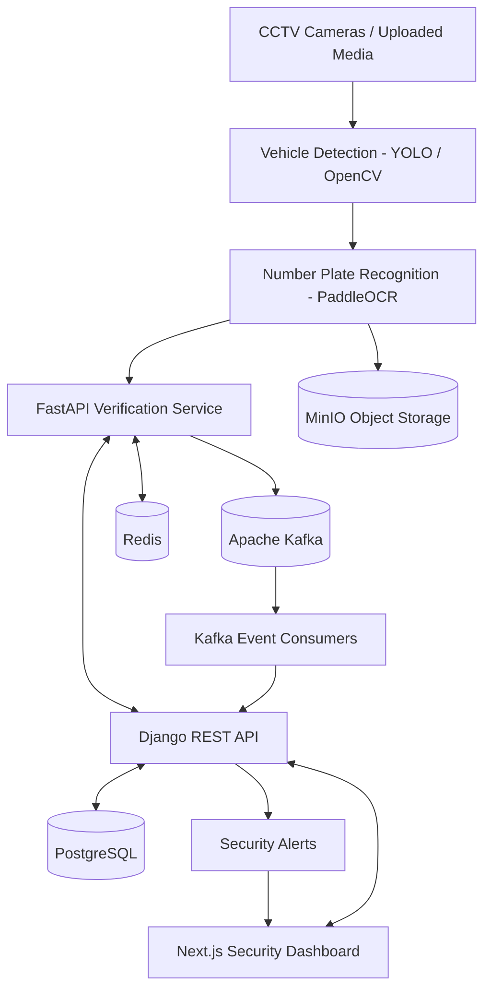

# System Architecture – Estate Car Theft Detection System

## 1. Introduction

This document describes the technical architecture of the Estate Car Theft Detection System.

The system uses a modular, service-oriented architecture combining computer vision, backend APIs, event streaming, relational storage and a web-based monitoring interface.

The architecture is designed to support multiple residential estates and multiple vehicle entry and exit points.

## 2. Architectural Goals

The architecture aims to:

- Automate vehicle identification using computer vision.
- Verify vehicle authorization before entry and exit.
- Process vehicle events with low latency.
- Maintain consistent vehicle movement records.
- Detect suspicious vehicle activities.
- Provide real-time security monitoring.
- Support independent service scaling.
- Preserve evidence for incident investigation.

## 3. High-Level Architecture

The system consists of the following layers:

1. Input and capture layer.
2. Computer vision and recognition layer.
3. Verification and business logic layer.
4. Event streaming layer.
5. Data storage layer.
6. Presentation layer.

### Architecture Diagram



## 4. Architectural Components

### 4.1 Input and Capture Layer

Responsible for receiving vehicle images and video streams.

Supported input sources:

- CCTV cameras.
- Uploaded vehicle images.
- Uploaded video files.
- Simulated camera events.

Responsibilities:

- Capture vehicle images.
- Identify gate and camera information.
- Attach event timestamps.
- Forward media for processing.

The prototype initially uses uploaded media and simulated camera events.

### 4.2 Vehicle Detection Service

Technology:
- Python
- OpenCV
- YOLO

Responsibilities:

- Detect vehicles in image frames.
- Identify vehicle bounding boxes.
- Extract relevant image regions.
- Identify candidate number plate regions.
- Prepare images for recognition.

The service should operate independently from the main Django backend.

### 4.3 Number Plate Recognition Service

Technology:
- Python
- PaddleOCR
- OpenCV

Responsibilities:

- Extract registration numbers from detected plates.
- Normalize recognition output.
- Calculate recognition confidence.
- Return structured recognition results.
- Store or reference the original evidence in MinIO.

Example response:

```json
{
  "registration_number": "KDA123A",
  "confidence": 0.97,
  "recognition_status": "SUCCESS",
  "gate_id": "gate-uuid"
}
```

Recognition confidence represents the model's confidence in the extracted text, not certainty that the vehicle or driver has been correctly identified.

### 4.4 Verification Service

Technology:
- FastAPI
- Python
- Redis

Responsibilities:

- Receive recognition results.
- Query authoritative vehicle authorization through Django APIs.
- Verify vehicle registration.
- Check stolen vehicle reports.
- Validate visitor permissions.
- Check active vehicle sessions.
- Return entry or exit verification decisions.
- Publish relevant events to Kafka.

The service performs synchronous verification so gate decisions do not depend on asynchronous event consumers.

### 4.5 Core Backend Service

Technology:
- Django
- Django REST Framework
- PostgreSQL

The Django backend is the central business logic and data ownership layer.

Responsibilities:

- User authentication.
- Estate management.
- Resident management.
- Vehicle registration.
- Visitor registration.
- Visitor pass approval.
- Vehicle session management.
- Gate event management.
- Security alert management.
- Audit logging.
- API access control.

The backend is the authoritative source of vehicle and estate records.

### 4.6 Event Streaming Layer

Technology:
- Apache Kafka

Kafka handles asynchronous distribution of vehicle events.

Responsibilities:

- Distribute vehicle recognition events.
- Distribute entry and exit events.
- Trigger alert processing.
- Support event auditing.
- Enable future analytical processing.

Proposed topics:

| Topic | Description |
|---|---|
| vehicle.recognition | Number plate recognition results |
| gate.entry | Vehicle entry events |
| gate.exit | Vehicle exit events |
| vehicle.verification | Verification decisions |
| security.alerts | Security alerts |
| security.confirmations | Security officer decisions |
| system.dlq | Failed event processing |

Consumers should use idempotent processing and retry mechanisms.

Failed events should eventually be sent to the dead-letter queue.

### 4.7 Database Layer

Technology:
- PostgreSQL

Stores authoritative business information.

Main entities:

- Estate
- Gate
- User
- Resident
- Vehicle
- Visitor
- VisitorPass
- VehicleSession
- GateEvent
- RecognitionRecord
- SecurityAlert
- AuditLog

Django owns database writes and business transactions.

### 4.8 Cache Layer

Technology:
- Redis

Used for:

- Frequently accessed verification information.
- Short-lived temporary data.
- Request throttling.
- Temporary processing state where appropriate.

Redis is not the authoritative storage for vehicle records or movement sessions.

### 4.9 Object Storage Layer

Technology:
- MinIO

Stores large media files independently from PostgreSQL.

Stored objects may include:

- Vehicle entry snapshots.
- Vehicle exit snapshots.
- Number plate crops.
- Security incident images.
- Relevant video clips.

PostgreSQL stores object references and metadata rather than large binary media files.

### 4.10 Presentation Layer

Technology:
- Next.js
- TypeScript

Provides the interface for:

- Security officers.
- Estate managers.
- System administrators.
- Residents.

Dashboard functionality:

- Vehicle entry and exit monitoring.
- Registered vehicle management.
- Visitor authorization.
- Active vehicle sessions.
- Security alerts.
- Recognition history.
- Incident investigation.
- Audit history.

## 5. Vehicle Entry Workflow

1. A vehicle arrives at the entrance.
2. The capture component receives an image.
3. YOLO detects the vehicle and its number plate region.
4. PaddleOCR extracts the registration number.
5. The evidence is stored in MinIO.
6. The recognition service sends the result to FastAPI.
7. FastAPI requests verification from Django.
8. Django checks the vehicle and visitor authorization records.
9. The verification service returns the decision.
10. If authorized, Django creates an active vehicle session.
11. The system publishes the entry event to Kafka.
12. Consumers process the event asynchronously.
13. The dashboard displays the updated vehicle activity.

If recognition confidence is insufficient, the system requests manual verification.

## 6. Vehicle Exit Workflow

1. A vehicle arrives at an exit gate.
2. The capture component obtains an image.
3. The recognition service extracts the registration number.
4. The verification service requests an exit check.
5. Django searches for the corresponding active vehicle session.
6. The system checks registration consistency and vehicle authorization.
7. If the vehicle is reported stolen or verification fails, an alert is generated.
8. If verification succeeds, the vehicle session is closed.
9. The exit event is published to Kafka.
10. The dashboard updates the movement history.

## 7. Event Processing Architecture

The system uses asynchronous processing to separate gate verification from downstream event handling.

The verification decision is made synchronously.

Kafka is used for:

- Event distribution.
- Security notifications.
- Audit processing.
- Analytics.
- Integration with future services.

Every event should include a unique identifier, estate identifier, gate identifier, event type and timestamp.

## 8. Security Architecture

Security measures include:

- JWT or token-based authentication.
- Role-based access control.
- Secure password hashing.
- HTTPS in production.
- Restricted access to CCTV evidence.
- Environment-based secret management.
- Database access restrictions.
- Kafka authentication and encryption in production.
- Audit logging.
- Rate limiting.

Access to resident information and security evidence must be restricted according to user roles.

## 9. Reliability and Fault Tolerance

The system should support:

- Kafka retries.
- Dead-letter queues.
- Idempotent event consumers.
- PostgreSQL transactions.
- Database backups.
- Service health checks.
- Recognition failure fallback.
- Manual verification.
- Monitoring and structured logging.

A temporary Kafka outage should not cause the system to authorize an otherwise unauthorized vehicle. Event publication failures must be recoverable, preferably through a transactional outbox pattern.

## 10. Deployment Architecture

Development environment:

- Docker Compose.
- PostgreSQL.
- Apache Kafka.
- Redis.
- MinIO.
- Django.
- FastAPI.
- Next.js.

Production deployment may use:

- Multiple application instances.
- Managed PostgreSQL.
- Kafka cluster.
- Object storage.
- Reverse proxy.
- TLS certificates.
- Centralized logging and monitoring.
- Automated backups.

## 11. Scalability Considerations

The architecture supports:

- Multiple gates per estate.
- Multiple estates.
- Independent recognition workers.
- Independent Kafka consumers.
- Increased API instances.
- Increased database capacity.
- Distributed object storage.

Services can be scaled independently as system usage increases.

## 12. Conclusion

The proposed architecture provides a modular and scalable foundation for intelligent vehicle security monitoring.

It combines synchronous authorization with asynchronous event processing to support reliable vehicle entry and exit verification, security alerts and historical movement tracking.